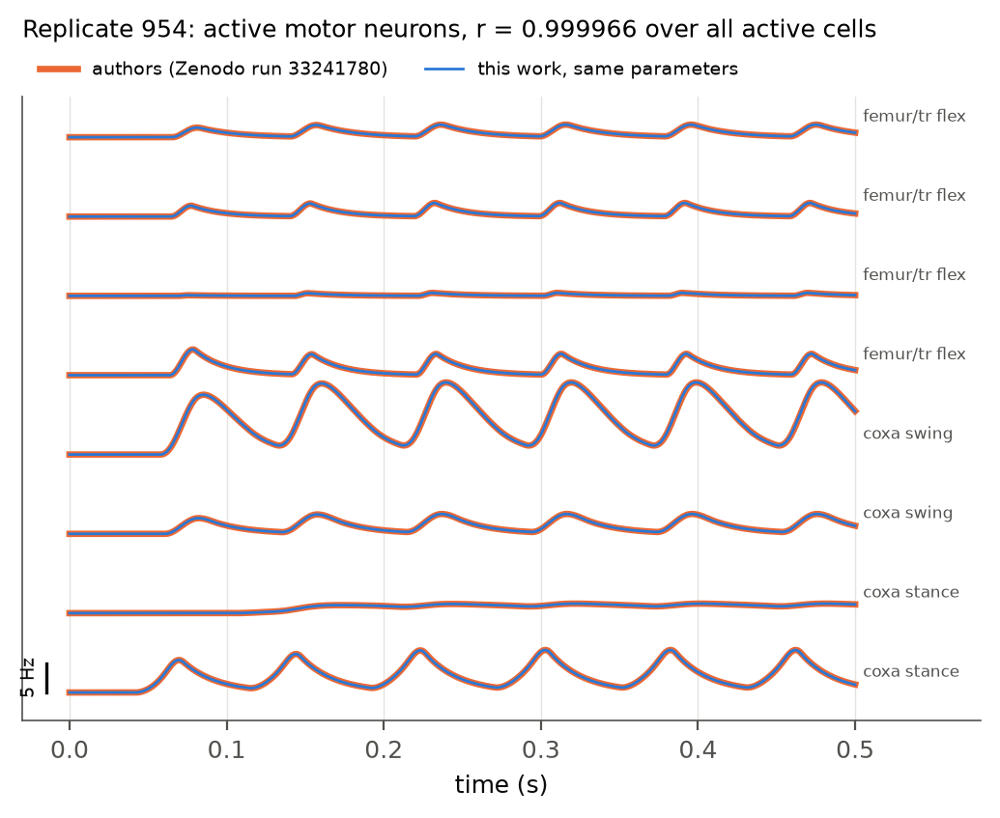
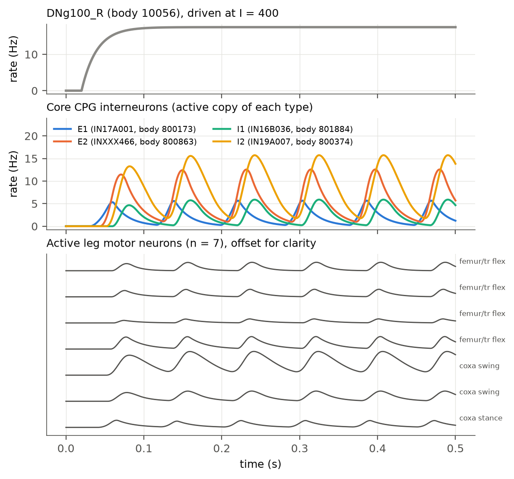
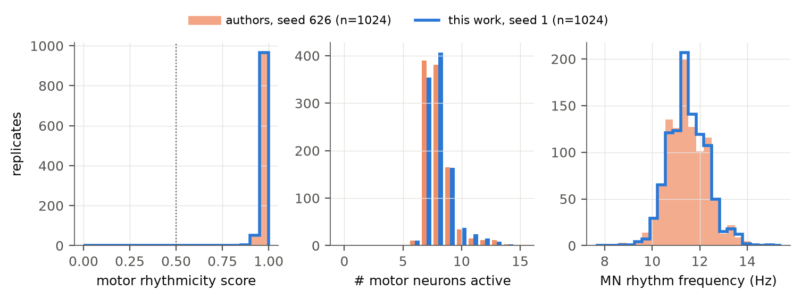
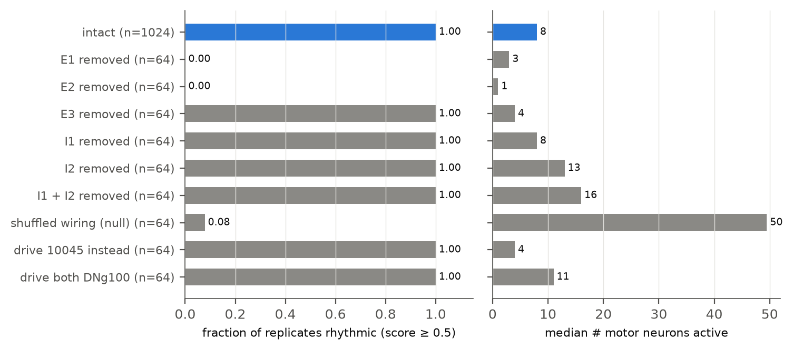
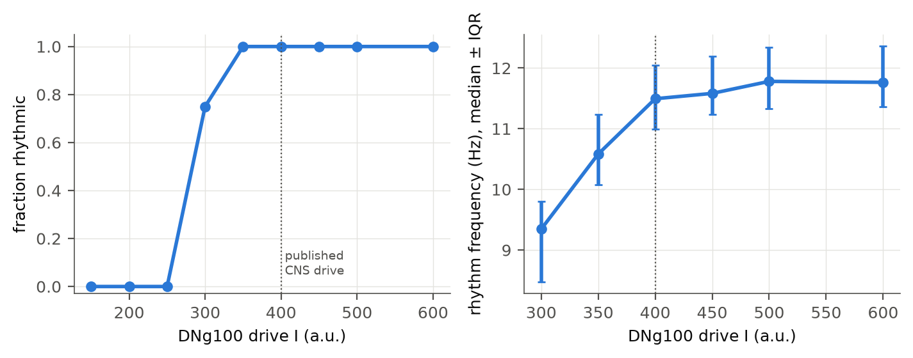

# Reproducing a connectome-derived walking rhythm on the male *Drosophila* CNS: validating the neural foundation of a persistent digital fly

**Paper 1 of the virtual *Drosophila* project** · Zayan ([@mzyazuan12](https://github.com/mzyazuan12)) · draft of 11 November 2026

Repository: [digital-fly-learns-to-play-my-game](https://github.com/mzyazuan12/digital-fly-learns-to-play-my-game). Every number in this paper comes from saved experiment output that a command in [Reproducibility](#9-reproducibility) regenerates; the summaries behind the tables and figures are committed under [`docs/papers/data/`](data/).

---

## Abstract

The long-term goal of this project is a persistent, embodied digital fruit fly: one individual with a body, senses, a nervous system grounded in measured anatomy, internal state, memory and learning, living continuously in a simulated world. Before any of that is trusted, the neural layer has to be shown to produce real biology and not artefacts of our own code. This paper reports that validation for walking, the first behaviour the body needs.

We take the published connectome-simulation result of Pugliese et al. (2025/2026), which found that stimulating the descending neuron DNg100 in a firing-rate model of the front-leg nerve-cord network produces a ~11 Hz rhythm in leg motor neurons through a small central pattern generator (CPG). We reproduce it in three steps, each with an explicit pass/fail gate. (1) Our port of the authors' rate equation reproduces their own MANC traces (mean correlation 0.99996). (2) On the authors' exact 4,310-neuron male-CNS (MaleCNS v1.0) subnetwork, our parameter sampler and size normalization reproduce every one of their 4 × 1,024 × 4,310 sampled neuron parameters to float32 precision, and our integrator, given their parameters, reproduces their published traces replicate by replicate. (3) Driving MaleCNS DNg100_R (body 10056) at the published CNS amplitude (I = 400) in 1,024 independently sampled networks produces rhythmic leg motor output in 100% of networks at a median of 11.49 Hz, indistinguishable from the authors' own 1,024 runs, with the identified CPG interneurons E1, E2, E3, I1 and I2 oscillating at the same frequency. Removing E1 or E2 abolishes the rhythm, as in the authors' own lesions; removing the inhibitory I1 and I2 does not, but slows and spreads it; shuffling the wiring while keeping every cell's parameters destroys it. Each DNg100 drives its own front leg, and the two legs' rhythms are not coupled. An amplitude sweep shows the rhythm switching on between I = 250 and 300, which explains an earlier apparent failure. Two limitations matter for the body: within a leg, swing and stance motor neurons are phase-offset by ~0.16 cycle rather than alternating, and the two legs are uncoupled.

Along the way we caught and corrected several errors that would have produced fake biology: a body-ID namespace collision between two connectomes, a wrong I2 cell type, a size-normalization denominator that silenced DNg100, and a stimulus amplitude that had been borrowed from the wrong dataset. We describe each, because the discipline that caught them is the main methodological contribution.

We make no claim about consciousness here. We discuss what this result does and does not establish for the larger organism, and how consciousness-relevant markers will be tested once the organism exists.

---

## 1. Introduction

### 1.1 The organism we are trying to build

The project's aim is a single persistent digital *Drosophila melanogaster*: a body (FlyBody/NeuroMechFly, simulated in MuJoCo), senses (vision, touch, proprioception), a nervous system whose topology is the measured male CNS connectome, internal drives and neuromodulatory state, memory and learning, all running as one continuous loop of perception, internal processing, action, consequence and memory. The organism is not scripted. There is no `go_to_fruit()` and no `play_shiritori()`; a game the fly later encounters, such as the word game Shiritori on a simulated monitor and keyboard, is one experience in its life, not its purpose.

The interesting scientific question is what organism-level behaviour can emerge from such an integrated system: whether one persistent individual can explore a world without a task, form stable preferences and spatial memories, acquire new skills through interaction, and carry them across unrelated environments. A further, much harder question is whether a system like this could ever have properties relevant to consciousness. We return to that in [Section 7](#7-on-consciousness).

### 1.2 Why validate the neural layer first

A connectome gives which neurons exist, which connect, how many synapses each connection has, and a predicted transmitter. It does not give membrane time constants, synaptic efficacy, receptor kinetics, neuromodulation or the live state of the animal. Any simulation fills those gaps with assumptions. A simulated fly that walks can therefore walk for the wrong reason: an engineered oscillator, a tuned gain, a mislabelled cell, or a normalization constant that happens to push activity into a convenient range. A digital organism built on a neural layer like that would be a puppet with a connectome painted on it.

So the project adopted a rule: no neural result is used to drive the body until it reproduces a published, independently derived biological result on the same data, with every source of difference between our implementation and the original either eliminated or measured.

### 1.3 The target result

Pugliese et al. (2025/2026) built a firing-rate model of the neurons controlling one front leg in the male adult nerve cord connectome (MANC), screened descending neurons for those whose activation produces rhythmic leg motor activity, and found DNg100 as the strongest driver. Synthetic pruning reduced the circuit to a minimal core of two excitatory interneurons and one inhibitory interneuron, within a set of identified CPG cell types: excitatory E1 (IN17A001), E2 (INXXX466) and E3 (IN19B012), and inhibitory I1 (IN16B036) and I2 (IN19A007). They predicted that DNg100 drives walking and confirmed rhythmic leg movement with optogenetics in behaving flies. They then reran the model on three other connectomes, including the male CNS (mCNS, the dataset this project uses), and report that DNg100 produced rhythmic motor activity in all four.

That makes it an ideal first gate. It is (i) a causal claim about walking, the first behaviour the body needs; (ii) made on the same connectome we use; (iii) backed by open code (`smpuglie/Pugliese_2026`, commit `10e7661`) and open simulation data (Zenodo record 22260924); and (iv) independent of every assumption in our own codebase.

### 1.4 Contributions

1. A port of the authors' rate model that reproduces their MANC traces at r = 0.99996 and their mCNS sampled parameters to float32 precision.
2. Resolution of the last open unknown in the mCNS reproduction (the stimulus amplitude), from the paper's Methods and then confirmed against the authors' archived run configuration.
3. A 1,024-replicate reproduction of DNg100-driven rhythm on the authors' exact 4,310-neuron mCNS network with an independent random seed, plus a trace-level comparison with nine of the authors' archived runs and a population-level comparison with all 1,024 of them.
4. Perturbation arms the original mCNS analysis did not report (E3, I1 and I1 + I2 lesions, a shuffled-wiring null, drive side, an amplitude sweep), plus a measurement of swing/stance phase and left/right coupling.
5. A record of the identity, namespace and normalization errors caught on the way, and the gates that now prevent them.

---

## 2. Related work

**Connectomes.** Whole-brain (FlyWire; Dorkenwald et al. 2024; Schlegel et al. 2024), nerve-cord (MANC, Takemura et al. 2024, Marin et al. 2024, Cheong et al. 2024; FANC, Azevedo et al. 2024) and now whole-CNS (male CNS v1.0, Janelia FlyEM; Berg et al. 2025) reconstructions make connectome-constrained simulation possible across the entire fly nervous system. This project uses MaleCNS v1.0: 166,700 retained neurons and 25,582,938 directed edges (124,177,617 synaptic contacts) under our inclusion rule.

**Connectome-constrained simulation.** Shiu et al. (2024) simulated the whole FlyWire brain as leaky integrate-and-fire (LIF) neurons with uniform parameters and predicted sensorimotor pathways that were then confirmed experimentally. Lappalainen et al. (2024) trained connectome-constrained models of the visual system that predict neural responses. Pugliese et al. (2025/2026) used a firing-rate model of nerve-cord circuits to find the walking CPG reproduced here.

**Bodies.** NeuroMechFly (Lobato-Rios et al. 2022) and NeuroMechFly v2 / FlyGym (Wang-Chen et al. 2024) provide an anatomically detailed, physics-simulated fly body with sensory inputs; Vaxenburg et al. (2025) built a whole-body fly model in MuJoCo (Todorov et al. 2012) trained to walk and fly.

**Embodied connectome demonstrations.** In early 2026 the company Eon Systems publicised a FlyWire-based brain model coupled to a NeuroMechFly body in MuJoCo, showing walking, grooming and feeding-like behaviour. As of this writing we found press coverage and company material but no peer-reviewed paper, and coverage notes that brain activity was translated into higher-level body commands rather than driving individual muscles. We treat it as closely related prior work, not as a validated result.

**Position of this work.** This paper is not new biology. It is a validation study: it establishes that the neural substrate of a long-lived embodied organism reproduces a published causal walking result on the organism's own connectome, with every implementation choice checked against the original. What is new is the end-to-end check on mCNS (parameter-level and trace-level agreement, perturbation arms the original did not report) and the provenance discipline that makes later embodied results interpretable.

---

## 3. Data and identities

### 3.1 MaleCNS v1.0

Three official files define the topology: `connectome-weights-male-cns-v1.0-minconf-0.5.feather`, `body-annotations-male-cns-v1.0-minconf-0.5.feather` and `body-neurotransmitters-male-cns-v1.0.feather`, from male-cns.janelia.org. Synapse point clouds and SWC skeletons are used for anatomy checks only. Graph orientation is `W[pre, post]`; a spot check confirms the direction (MaleCNS 10045 → 800316 has 20 contacts; the reverse has none).

### 3.2 Identities, and the errors they hid

Cell identity is taken from the official annotation `type` column joined on `bodyId`, never from a derived table, an integer that happens to match, or a pooled type-level ROI total.

- **DNg100.** In MaleCNS, `type == "DNg100"` gives exactly two neurons: body 10045 (DNg100_L) and body 10056 (DNg100_R). Pugliese's MANC stimulus is MANC body 10093 (matrix index 31). In the MANC table, integer 10056 is a different cell, vMS16, a GABAergic neuron, and MaleCNS body 10093 is Am1. An earlier version of our pipeline joined across datasets on the integer and was archived as `cpg_mapping.INVALID_pre_namespace_fix.json`. Body IDs are now namespaced by dataset.
- **I2.** I2 is IN19A007 (six copies across T1–T3, predicted GABAergic), as in Pugliese et al. An earlier assignment used IN19B007, a different two-neuron type. It is now locked in `cpg_mapping.json` with provenance.
- **Leg and side.** Each CPG cell's segment and side come from its own synapses (PreSyn + PostSyn in `LegNp(T#)(L/R)`, confidence threshold 0.7, no fallback), never from soma position or type-level pooling. All six cells of each core type are assigned this way. An earlier mapping that used other signals is archived as `cpg_mapping.INVALID_pre_roi.json`.
- **Which DNg100 to drive.** MaleCNS 10056 has `somaSide = R`, but its curated MANC correspondence is MANC 10093 (the authors' stimulated cell) and its leg-neuropil innervation is on the left. It was pre-registered as the stimulated cell before the authors' configuration was available. That configuration later confirmed it ([Section 5.2](#52-the-authors-archived-run-confirms-the-stimulus)).

### 3.3 The authors' 4,310-neuron mCNS network

The authors ship their mCNS simulation network in the repository: `wTable_20260210_vncRoisOnly.csv` (4,310 neurons: 2,493 cholinergic, 1,011 GABAergic, 606 glutamatergic, 193 unclear, 4 histaminergic, 2 serotonergic, 1 blank) and `W_20260210_vncRoisOnly.csv` (signed synapse counts, 118,920 non-zero entries: 66,544 excitatory, 52,376 inhibitory). It contains 1,236 descending, 2,378 intrinsic, 328 ascending, 232 sensory and 130 motor neurons, with two copies of each core CPG type (one per front leg). Every row is in the simulation; transmitter is not a membership filter, and W is already signed.

We also rebuilt the population from MaleCNS v1.0 using the paper's stated selection rules (front-leg motor neurons, their premotor partners, descending inputs, a ≥5-synapse VNC floor). That gives 4,301 neurons, intersecting the shipped table in 4,295 (15 shipped-only, 6 rebuild-only). We report it as a methods audit only: the reproduction uses the authors' shipped table, because the size normalization depends on exactly which neurons are in it.

---

## 4. Model

### 4.1 Rate equation

Each neuron *i* has a firing rate *R*<sub>*i*</sub>(*t*) obeying the authors' half-rectified tanh rate model:

```text
τ_i dR_i/dt = −R_i + max(0, r_max,i · tanh( (a_i / r_max,i) · (Σ_j W̃_ij R_j + I_i(t) − θ_i) ))
```

with W̃ = 0.03·max(Wᵀ, 0) + 0.03·min(Wᵀ, 0) (postsynaptic × presynaptic, from signed synapse counts), and per-neuron parameters drawn from truncated normals (lower bound 0): τ ~ N(20 ms, 2 ms), *a* ~ N(1, 0.1), θ ~ N(7.5, 0.6), *r*<sub>max</sub> ~ N(200 Hz, 10 Hz). Each replicate is one independent draw of all 4 × 4,310 parameters, using the authors' sampler (`jax.random.split(PRNGKey(seed), 5)` and an inverse-CDF truncated normal). The stimulus is a tonic current *I* on the driven neuron from 20 ms to 1.999 s; simulations last 2 s, sampled every 1 ms. We integrate with SciPy's RK45 (Dormand–Prince) at the authors' tolerances (rtol 2×10⁻⁶, atol 5×10⁻⁹); the authors use Diffrax's Dopri5, the same method family.

### 4.2 Size normalization

Larger neurons need more input to reach threshold. The authors scale each neuron's gain and threshold by its volume relative to the median of the simulated population, *s*<sub>*i*</sub> = size<sub>*i*</sub> / nanmedian(size): *a*<sub>*i*</sub> ← *a*<sub>*i*</sub> / *s*<sub>*i*</sub> and θ<sub>*i*</sub> ← θ<sub>*i*</sub> · *s*<sub>*i*</sub>. For mCNS, size is the neuPrint `volume` property. Over the shipped 4,310 neurons the median is 998,603,428.5 (every row has a positive size). DNg100_R is 16.6 times the median, because its brain arbor is part of the reconstruction, so its mean threshold becomes about 124. This is why the CNS datasets need a larger DNg100 drive than MANC.

### 4.3 Stimulus amplitude

The authors' Methods state: "For DNg100 activation, I_stim = 250 in MANC, 150 in FANC, and 400 in the two CNS datasets". The MANC value matches the shipped `DNg100_Stim.yaml`, which cross-checks the sentence. We use I = 400 as `stimulus_source = authors_mcns`; any other amplitude is labelled `amplitude sweep`.

### 4.4 Read-outs (identical to the authors' notebooks)

- **Motor neurons:** wTable rows with a non-null `motor module` (129 neurons).
- **Active:** rate > 0.01 Hz at any time after 250 ms.
- **Motor rhythmicity score:** the authors' `compute_oscillation_score` (autocorrelation-peak based, prominence 0.05) on *R*[:, 250:], averaged over active motor neurons; a replicate is **rhythmic** if the score is ≥ 0.5, the authors' `oscillation_threshold`.
- **Frequency:** the authors' per-neuron frequency estimate averaged over active neurons, in cycles per sample, divided by *dt*.
- **CPG roles:** the same score on the active copies of E1, E2, E3, I1 and I2.

Published walking-frequency ranges are annotations only: no read-out restricts or selects a frequency band.

### 4.5 Experimental arms

All arms use the same 4,310-neuron network and the same per-replicate parameter draws (seed 1, replicate *k* of a 1,024-replicate block), so arms differ only in the intended manipulation.

| Arm | Drive | Manipulation | Replicates |
|---|---|---|---:|
| intact | 10056, I = 400 | none | 1,024 |
| E1 / E2 / E3 / I1 / I2 / I1 + I2 removed | 10056, I = 400 | both copies of the type removed from W (rows and columns), as the authors' `removeNeurons` | 64 each |
| shuffled wiring | 10056, I = 400 | postsynaptic targets permuted within DN-exc, DN-inh, interneuron-exc, interneuron-inh and MN groups (the authors' `shuffle_W` groups), new permutation per replicate | 64 |
| drive 10045 | 10045, I = 400 | other DNg100 | 64 |
| drive both | 10045 + 10056, I = 400 each | bilateral | 64 |
| amplitude sweep | 10056, I = 150 … 600 | none | 32 per level |

### 4.6 Numerical engineering

W is 0.6% dense, so integration uses a CSR sparse matrix product. On replicate 0 the sparse and dense integrations agree at r = 0.9999987 (max difference 0.055 Hz, at the level of adaptive-step error); a unit test checks agreement within integrator tolerance. The authors' oscillation score masks inactive neurons out of its average, so we evaluate it on active rows only, which gives identical values (checked to 10⁻⁷).

### 4.7 Gates

Every experiment directory is new (existing outputs are refused), records the git commit, data SHA-256 hashes and stimulus provenance, and preserves failures. Scientific permission flags default to false; a full-MaleCNS run, body coupling and lesions each require their prerequisite gate to have passed. Rates must be finite and within the firing-rate cap. Recruitment of the required populations is checked before any spectral analysis, and an FFT on an unrecruited population is refused.

---

## 5. Results

### 5.1 The validation ladder

The project reached the mCNS experiment through a sequence of gates. Each row below is a saved, timestamped experiment; failures are kept.

| Step | Model and network | Result | Role in this paper |
|---|---|---|---|
| Numerical sanity | Shiu-style LIF, single cells and pairs | Rest, positive drive, ACh excitation, GABA inhibition, units, 1/5/10/20-contact scaling, graph direction: all pass | Engine is numerically sound |
| Tiny biological circuit | All-LIF, uniform constants, 32 core MaleCNS cells + 376 motor read-outs, 40 mV-equivalent drive | Left DNg100 (10045): fails voltage gate (−105.9 mV). Right (10056): passes gates, but no CPG rhythm (only spike-timing peaks at 273/409 Hz) | Negative result; motivates the authors' rate model rather than LIF tuning |
| Authors' original code | Authors' Hydra entrypoint, MANC T1 (4,604 neurons), DNg100 = MANC 10093, I = 250, 2 replicates | E1/E2 rhythm, scores 0.90/0.90 at 11.0/10.9 Hz | Target behaviour exists and runs locally |
| MANC port check | Our integrator on the authors' MANC network and sampled parameters | Mean trace correlation 0.99996 with the authors' traces | Our equation and integrator are the authors' |
| Full-MaleCNS-median control | 408-cell restricted MaleCNS graph, sizes normalised by the median of all MaleCNS neurons (178,403,737) | Silent | Wrong denominator; demoted to a control (Appendix A5) |
| MANC-amplitude control | Authors' 4,310-cell mCNS network, I = 250 | DNg100_R reaches 7.5 Hz; E1 weakly recruited; E2, I1, I2 and MNs not recruited; no rhythm | Wrong amplitude; kept as a control (A6) |
| **mCNS, published amplitude** | Authors' 4,310-cell mCNS network, I = 400 | Sections 5.2–5.8 | **This paper** |

### 5.2 The authors' archived run confirms the stimulus

The authors' Zenodo archive for the mCNS DNg100 experiment (`DNg100_Stim_IMAC_vncOnly`, run 33241780, MD5 verified) contains the run configuration, the per-neuron parameters actually used and all 1,024 rate traces. The configuration sets `stimNeurons = [[9]]`, `stimI = [[400]]`, `seed = 626`, `n_replicates = 1024`, T = 2 s, dt = 1 ms, rtol 2×10⁻⁶, atol 5×10⁻⁹. Matrix index 9 is MaleCNS body 10056: the cell this project had pre-registered from anatomy before the configuration was available. The stored `input_currents` are non-zero only at index 9, with value 400, in every replicate. The stimulus question is closed by two independent sources (the paper's text and the archived configuration).

### 5.3 Parameter-level and trace-level agreement with the authors

**Weights.** The authors' stored W equals the shipped CSV W[pre, post] exactly (maximum absolute difference 0).

**Parameters.** Running our sampler at the authors' seed (626) for a 1,024-replicate block and applying our size normalization reproduces all four of their stored parameter arrays (τ, *a*, θ, *r*<sub>max</sub>; each 1,024 × 4,310) to a maximum relative difference of 2.9 × 10⁻⁷, which is float32 storage precision. Without size normalization the gain and threshold differ by up to 100-fold, so this match independently confirms that the denominator is the median of the simulated 4,310-cell table and not of the whole connectome.

**Traces.** We integrated nine of the authors' replicates (0–7 and 954, the example shown in their Figure 2) with their exact parameters and compared them with their stored traces (Figure 1, Table 1). Across all neurons active in either run, the mean correlation is 0.99998 (minimum 0.99988). In all nine replicates the set of active neurons is identical, and so is the number of active motor neurons. The motor rhythmicity score agrees to within 4 × 10⁻⁴, and the frequency is identical in eight of nine (11.67 versus 11.69 Hz in the ninth). The largest pointwise difference is 0.34 Hz, from the different Dopri5 implementations (SciPy, float64, versus Diffrax, float32).



*Figure 1. Replicate 954 of the authors' published mCNS run (orange, thick) and our integration with the same parameters (blue, thin), for every active motor neuron, labelled by motor module. The traces overlap within line width.*

*Table 1. Trace-level comparison with the authors' archived replicates.*

| Replicate | r (active cells) | Same active set | MNs active (ours/theirs) | Score (ours/theirs) | Frequency, Hz (ours/theirs) |
|---:|---:|:---:|:---:|:---:|:---:|
| 0 | 0.999993 | yes | 7/7 | 0.9990/0.9990 | 11.48/11.48 |
| 1 | 0.999885 | yes | 7/7 | 0.9851/0.9851 | 10.53/10.53 |
| 2 | 1.000000 | yes | 8/8 | 0.9755/0.9751 | 12.05/12.05 |
| 3 | 0.999985 | yes | 8/8 | 0.9590/0.9590 | 10.22/10.22 |
| 4 | 0.999995 | yes | 7/7 | 0.9894/0.9892 | 11.67/11.69 |
| 5 | 0.999985 | yes | 8/8 | 0.9996/0.9996 | 13.16/13.16 |
| 6 | 1.000000 | yes | 8/8 | 0.9957/0.9960 | 11.90/11.90 |
| 7 | 0.999999 | yes | 8/8 | 0.9990/0.9990 | 11.63/11.63 |
| 954 | 0.999966 | yes | 8/8 | 0.9993/0.9993 | 12.50/12.50 |

**The authors' population.** Scoring all 1,024 of the authors' stored replicates with their own read-outs: **100% are rhythmic** (score ≥ 0.5); the median score is 0.994 (IQR 0.977–0.999, minimum 0.824); a median of 8 motor neurons are active (range 6–15); the median frequency is **11.49 Hz** (IQR 10.99–12.05, range 8.1–14.5). E1, E2, E3, I1 and I2 are each active and rhythmic (score ≥ 0.5) in 100% of replicates, with median scores of 0.999.

**Lateralization and phase.** In every one of the authors' replicates the active copy of E1, E2, I1 and I2 is the left-soma cell and the active copy of E3 is the right-soma cell. Motor output is left-leg in all replicates, with additional right-leg motor neurons active in 450 of 1,024. Coxa-swing, coxa-stance and femur/trochanter-flexor modules are active in every replicate. Their phases are tightly locked but **not in antiphase**: relative to coxa swing, coxa stance sits at 0.84 cycles (that is, leading by 0.16 cycle; circular resultant 0.94) and femur/trochanter flexion at 0.98 cycles (nearly in phase; resultant 0.997). The network produces a robust rhythm, but not by itself a clean swing/stance alternation. We return to this in [Section 6.2](#62-what-is-not-established).

### 5.4 Independent reproduction: 1,024 new networks at the published drive

With an independent seed (1) and a fresh 1,024-replicate parameter block, driving DNg100_R (10056) at I = 400 gives (Figures 2 and 3):

| Read-out | This work (seed 1, n = 1,024) | Authors (seed 626, n = 1,024) |
|---|---:|---:|
| Replicates rhythmic (score ≥ 0.5) | **100%** | 100% |
| Motor rhythmicity score, median (IQR) | 0.991 (0.975–0.999) | 0.994 (0.977–0.999) |
| Motor neurons active, median (range) | 8 (6–15) | 8 (6–15) |
| Rhythm frequency, median (IQR) | **11.49 Hz** (10.99–12.05) | 11.49 Hz (10.99–12.05) |
| E1, E2, E3, I1, I2 active and rhythmic | 100% each | 100% each |
| DNg100_R tonic (score 0) | 100% | 100% |
| Rates finite and below cap | 100% | 100% |

The two independent 1,024-network samples give indistinguishable distributions (Figure 3). DNg100 itself is tonic; the rhythm is generated downstream of it. In every replicate the active E1, E2, E3, I1 and I2 cells are rhythmic; in the example network of Figure 2, E1 leads each cycle and E2, I2 and I1 follow within ~20 ms.



*Figure 2. One network (seed 1, replicate 0). Top: DNg100_R rises to a tonic ~17 Hz under constant drive. Middle: the active copy of each core CPG type oscillates at ~12 Hz. Bottom: the seven active leg motor neurons, labelled by motor module.*



*Figure 3. Distributions over 1,024 networks for the authors' archived run (orange, seed 626) and this work (blue, seed 1): motor rhythmicity score (dotted line, rhythmic threshold 0.5), number of active motor neurons, and rhythm frequency.*

### 5.5 Which cells the rhythm needs

Removing a cell type deletes both of its copies from W (rows and columns), with the same parameters and drive as the intact networks (Figure 4). The authors' repository includes their own mCNS lesion results for three of these cell types (1,024 networks each), shown for comparison.

| Removed | Rhythmic (this work, n = 64) | Rhythmic (authors, n = 1,024) | Median MNs active (this work / authors) | Frequency, median |
|---|---:|---:|:---:|---:|
| none | 100% | 100% | 8 / 8 | 11.5 Hz |
| E1 (IN17A001) | **0%** | 0.8% | 3 / 4 | none |
| E2 (INXXX466) | **0%** | 0% | 1 / 2 | none |
| E3 (IN19B012) | 100% | not tested | 4 / – | 16.4 Hz |
| I1 (IN16B036) | 100% | not tested | 8 / – | 10.8 Hz |
| I2 (IN19A007) | 100% | 100% | 13 / 13 | 10.0 Hz |
| I1 + I2 | 100% | not tested | 16 / – | 8.5 Hz |

Where both exist, our lesion results match the authors'. (Their archived summary does not record whether one or both copies of a type were removed; we remove both, which may explain why our lesioned networks recruit one motor neuron fewer.) The rhythm needs both excitatory core cells: without E1 or E2, motor neurons are still driven (E1 removed) or nearly silent (E2 removed), but nothing oscillates. Neither identified inhibitory cell is required, even when both are removed together; but inhibition shapes the rhythm. Removing I2 widens recruitment from 8 to 13 motor neurons. Removing both I1 and I2 slows the rhythm from 11.5 to 8.5 Hz, lowers the median score from 0.99 to 0.85 and doubles recruitment to 16 motor neurons. Removing E3 speeds the rhythm to 16.4 Hz and halves recruitment. In this network, then, E1 and E2 are the rhythm generator, and I1, I2 and E3 set its speed and how far it spreads. The network contains about 1,600 other inhibitory neurons, so "not required" means not required *in the presence of the rest of the network*.



*Figure 4. Fraction of rhythmic networks and median number of active motor neurons for each arm. Blue: intact reference.*

### 5.6 The wiring, not the cell parameters, makes the rhythm

In the shuffled-wiring null, each neuron keeps its parameters, transmitter sign, class and outgoing synapse weights, but which neurons receive those synapses is permuted within the authors' five classes, with a new permutation per network. DNg100 is still driven in every network, and motor output becomes much broader (median 50 motor neurons active versus 8). In 59 of 64 networks it is not rhythmic. The remaining 5 cross the score threshold weakly (0.55–0.70), at 1.4–3.2 Hz, across 33–59 motor neurons: slow network-wide swells, not the ~11 Hz CPG rhythm. Core CPG cells are rhythmic in at most 6% of shuffled networks. None of the 64 reproduces the intact pattern. The rhythm therefore depends on the measured connectome wiring, not on the cell parameters, transmitter balance or weight distribution alone.

### 5.7 Each DNg100 drives its own leg; the legs are not coupled

- **Drive 10045 (DNg100_L) instead:** 100% rhythmic, 13.1 Hz (IQR 12.5–14.3), median 4 motor neurons, all on the right leg (8 of 8 inspected networks).
- **Drive 10056 (DNg100_R):** motor output on the left leg (with an occasional single right motor neuron).
- **Drive both:** 100% rhythmic, median 11 motor neurons on both legs. In 7 of 8 inspected networks the two legs run at different frequencies (left 10.7–12.0 Hz, right 11.3–16.0 Hz) with no consistent phase relation between them.

Each front leg has its own DNg100-driven rhythm generator, and in this one-segment network the two are independent oscillators. Real walking requires coordinated legs; that coordination must come from circuitry or feedback outside this network.

### 5.8 Dose response: why the MANC amplitude looked like a failure

DNg100_R's large normalized size gives it a high threshold (mean ≈ 124), so the drive needed on mCNS is higher than on MANC (Figure 5).

| I | 150 | 200 | 250 | 300 | 350 | **400** | 450 | 500 | 600 |
|---|---:|---:|---:|---:|---:|---:|---:|---:|---:|
| Rhythmic | 0% | 0% | 0% | 75% | 100% | **100%** | 100% | 100% | 100% |
| Any MN active | 0% | 0% | 12.5% | 91% | 100% | 100% | 100% | 100% | 100% |
| Median MNs | 0 | 0 | 0 | 5 | 7 | 8 | 11 | 14 | 15.5 |
| Frequency, Hz | – | – | – | 9.4 | 10.6 | 11.5 | 11.6 | 11.8 | 11.8 |

The rhythm switches on between I = 250 and 300; above that, frequency rises and saturates near 11.8 Hz, while recruitment keeps growing. I = 250, the MANC value, sits just below the rhythm threshold in all 32 networks, which fully explains the earlier "no rhythm" control: the circuit was fine, the drive was too weak. The published I = 400 sits on the plateau, where results are insensitive to the exact amplitude (350–600 all give 100% rhythmic, 10.6–11.8 Hz).



*Figure 5. Fraction of rhythmic networks and rhythm frequency (median and IQR over rhythmic networks) as a function of DNg100_R drive. n = 32 per level; n = 1,024 at I = 400.*

---


## 6. Discussion

### 6.1 What is now established

The neural layer that will drive the organism's legs is no longer a guess. On the male CNS connectome, the same cell the authors drove (DNg100_R, MaleCNS 10056), driven at the published amplitude, recruits the identified walking CPG and produces rhythmic leg motor output at 11.5 Hz in every one of 1,024 independently sampled networks. The rhythm needs E1 and E2, as in the authors' own lesions, and it disappears when the wiring is shuffled while every cell keeps its parameters. It is a property of the measured connectome, not of our code or of a lucky parameter draw. The implementation is not merely "similar to" the authors': given their parameters it reproduces their traces at r > 0.9998 replicate by replicate, and its own sampler reproduces their parameters to float32 precision. The two remaining differences (Dopri5 in SciPy versus Diffrax, float64 versus float32) change traces in the fourth decimal of the correlation and never change which neurons are active.

### 6.2 What is not established

- **This is a model, not a measurement.** Membrane time constants, gains, thresholds and the synapse-to-current scale are the authors' assumptions, randomised per replicate. The connectome fixes topology and synapse counts; the dynamics are a hypothesis, which the original paper tested with optogenetics in behaving flies and which we have not tested in animals.
- **One front leg's network, not the CNS.** The 4,310 neurons are the descending, premotor and motor neurons of the front legs inside the VNC ROIs. The rest of the brain is absent, so nothing here says how DNg100 is recruited in the first place.
- **No body yet.** Motor-neuron rates have not been mapped to muscles or joint torques. The organism still walks with FlyGym's engineered CPG (`MODE_ENGINEERED_CPG`); `MODE_NEURAL_CPG` records the motif without actuating joints.
- **Rhythm is not gait.** An ~11 Hz rhythm is in the range of fly stepping frequencies, but in this network, driven by a tonic descending input and without sensory feedback, the coxa-stance motor neurons lead coxa-swing by only ~0.16 cycle instead of alternating in antiphase, and femur flexors fire nearly in phase with swing (Section 5.3). Real stepping depends on proprioceptive and load feedback that this network does not receive. The output is therefore a validated rhythm generator, not yet a leg controller. When both DNg100 are driven, the two front legs oscillate at different frequencies with no consistent phase relation (Section 5.7): this one-segment network contains two independent leg oscillators, and nothing in it coordinates them.
- **Rate model only.** Our earlier all-LIF tiny-circuit model with uniform Shiu et al. constants did not produce the CPG rhythm. We did not tune it to do so; that negative result stands, and the model choice is now justified by agreement with an independent published result.

### 6.3 What the errors teach

Four of the errors in [Appendix A](#appendix-a-errors-caught-before-they-became-results) would each have produced a plausible-looking but false result: a namespace collision that would have driven a GABAergic cell instead of DNg100; a wrong I2 type; a normalization denominator that silenced DNg100 (the "MaleCNS does not reproduce" result that was correctly demoted to a control); and a stimulus amplitude borrowed from a different dataset. None of them was caught by looking at whether the fly "looked right". They were caught by tracing every number to a primary source and refusing to interpret a run until its provenance was complete. The same discipline has to carry into the embodied work, where it is much easier to fool oneself.

### 6.4 Consequences for the organism

The locomotor gate is open. The next stages can now be built on top of it:

1. **Neural motor bridge.** Map active motor modules (coxa swing/stance, femur/trochanter extend/flex, …) onto FlyBody actuators, and replace the engineered CPG for one leg, then six. The phase offset between swing and stance (§5.3) must be resolved first, by adding the proprioceptive and load feedback this network lacks, or by testing whether the full six-leg VNC network already supplies it, not by retuning parameters.
2. **Bilateral and multi-segment networks.** Extend from the front-leg network to all six legs, and test whether inter-leg coupling emerges from the full VNC wiring (§5.7 shows it does not within T1 alone), using the same validation pattern against published MANC/BANC results.
3. **Brain-to-VNC.** Connect the brain side of MaleCNS so that sensory input, not an injected current, recruits DNg100 and other walking DNs.
4. **Closed loop.** Body → senses → brain → VNC → body, with proprioceptive feedback.
5. **Persistent individual.** Memory (mushroom-body KC→MBON plasticity), drives and neuromodulation acting on identified circuits, running continuously.

Each stage gets its own published-result gate before its output is trusted.

---

## 7. On consciousness

The project's long-range question is whether a persistent, embodied, connectome-grounded organism could develop properties relevant to consciousness. This paper does not answer it: a firing-rate model of 4,310 neurons producing a walking rhythm is a motor circuit, and nothing in it is evidence for or against consciousness.

The question can be tested, though not with a single yes/no experiment. Nobody can prove that a real fruit fly is conscious either. What researchers do instead is test animals for specific markers, defined in advance, and argue from the pattern of results. The same standard can be applied to the digital fly, which can then be compared directly with real flies on the same tests:

- **Open-ended associative learning:** trace conditioning, second-order conditioning, learning new compound stimuli. Ginsburg & Jablonka (2019) propose this kind of "unlimited associative learning" as a marker of minimal consciousness.
- **Sentience criteria:** the evidence framework Birch et al. (2021) used for decapod crustaceans and cephalopods, including motivational trade-offs between noxious stimuli and reward, flexible wound-directed and protective behaviour, and associative learning beyond habituation.
- **Perturbational complexity:** perturb the network and measure the spatiotemporal complexity of its response. In humans this index separates conscious from unconscious states (Casali et al. 2013); here it can be compared between awake-like and sleep- or anaesthesia-like regimes of the same organism.
- **Self/world distinction:** efference copy, the brain's prediction of the sensory consequences of its own movements, has been recorded in *Drosophila* (Kim, Fitzgerald & Maimon 2015) and can be measured in the digital fly's visual system.
- **Global ignition and recurrent processing:** whether a stimulus near threshold either spreads through the network or dies out, with little in between; part of the indicator-property list surveyed by Butlin et al. (2023).
- **Persistence and individuality:** whether preferences and spatial memories are stable within one individual over long simulated time and differ between individuals born from the same anatomy.

The rule that makes this science is the same one used throughout this paper: write each test and its pass criterion down, commit it, and only then run it, with lesions and null controls. If the digital fly passes the markers real flies pass, for the reasons real flies pass them, that is a substantive result. We will report it as *evidence relevant to* consciousness, which is the strongest claim any current theory supports, and we will not write a variable called `consciousness`. Most of these tests need the whole organism (body, senses, brain, memory), which is why the neural foundation came first.

---

## 8. Conclusion

The neural foundation of the virtual fly reproduces a published, causally tested walking result on the fly's own connectome. On the authors' exact male-CNS network, our implementation matches their sampled parameters to float32 precision and their published traces replicate by replicate. In an independent 1,024-network sample it drives the identified CPG and produces rhythmic leg motor output at 11.5 Hz in every network, from the same descending neuron. The rhythm needs the excitatory core cells E1 and E2, matching the authors' own lesion results, and it vanishes when the wiring is shuffled. Two properties a walking leg needs are absent from this circuit on its own: a clean swing/stance alternation, and coupling between legs. Those define the next problem. This is the first gate of the organism, not the organism. It is the point at which the project can stop asking whether the neural layer is fake and start connecting it to a body.

---

## 9. Reproducibility

Environment: the repository's `.venv` (Python, NumPy, SciPy, JAX 0.9.2 for the authors' sampler and scorer). The authors' code is vendored at `third_party/Pugliese_2026`, commit `10e7661bf414ba7b4c2edf795cd36d0f878c17c0`.

```sh
# 1. MANC port check (authors' Hydra output → our integrator)
.venv/bin/python -m experiment.pugliese_rate_manc_portcheck

# 2. Authors' archived mCNS run (Zenodo 22260924, 846 MB, md5 75779631356162efa7e701847dbbb9a0)
mkdir -p data/zenodo_pugliese_22260924
curl -L -o data/zenodo_pugliese_22260924/DNg100_Stim_IMAC_vncOnly.zip \
  "https://zenodo.org/api/records/22260924/files/DNg100_Stim_IMAC_vncOnly.zip/content"
(cd data/zenodo_pugliese_22260924 && unzip -q DNg100_Stim_IMAC_vncOnly.zip -d extracted)
.venv/bin/python -m experiment.authors_mcns_zenodo_compare

# 3. Independent 1,024-replicate battery with all arms
./scripts/run_mcns_dng100_battery.sh

# 3b. Lateralization and swing/stance phase in the authors' 1,024 runs
.venv/bin/python -m experiment.mcns_motor_phase

# 4. Figures
.venv/bin/python scripts/make_paper1_figures.py --battery outputs/mcns_dng100_battery_<stamp> \
  --compare outputs/authors_mcns_zenodo_compare_<stamp> --out docs/papers/figures

# Tests
.venv/bin/python -m pytest -q --ignore=tests/test_connectome_full.py
```

Data hashes: `wTable_20260210_vncRoisOnly.csv` SHA-256 `593a75c5…dd5b2d`; `W_20260210_vncRoisOnly.csv` SHA-256 `255236ba…b58d3b4`. Each experiment directory's `report.json` records the git commit, hashes, parameters, stimulus provenance and per-replicate metrics. Summary JSON for this paper is committed under `docs/papers/data/`.

---

## 10. References

- Azevedo, A. et al. (2024). Connectomic reconstruction of a female *Drosophila* ventral nerve cord. *Nature*.
- Barron, A. B. & Klein, C. (2016). What insects can tell us about the origins of consciousness. *PNAS*.
- Berg, S. et al. (2025/2026). Sexual dimorphism in the complete connectome of the *Drosophila* male central nervous system. *bioRxiv* 10.1101/2025.10.09.680999; reported published in *Cell* (2026). Data: male CNS v1.0, https://male-cns.janelia.org.
- Birch, J., Burn, C., Schnell, A., Browning, H. & Crump, A. (2021). Review of the evidence of sentience in cephalopod molluscs and decapod crustaceans. LSE Consulting report for the UK government.
- Butlin, P., Long, R. et al. (2023). Consciousness in artificial intelligence: insights from the science of consciousness. *arXiv*:2308.08708.
- Casali, A. G. et al. (2013). A theoretically based index of consciousness independent of sensory processing and behavior. *Science Translational Medicine*.
- Cheong, H. S. J. et al. (2024). Transforming descending input into behavior: the organization of premotor circuits in the *Drosophila* male adult nerve cord connectome. *eLife*.
- Dorkenwald, S. et al. (2024). Neuronal wiring diagram of an adult brain. *Nature*.
- Dormand, J. R. & Prince, P. J. (1980). A family of embedded Runge–Kutta formulae. *J. Comput. Appl. Math.*
- Eon Systems (2026). Embodied fruit-fly brain emulation demonstration; press coverage, e.g. [ISPR, 21 April 2026](https://ispr.info/2026/04/21/researchers-upload-model-of-flys-brain-to-matrix-let-it-control-virtual-body/). Not peer reviewed at time of writing.
- Ginsburg, S. & Jablonka, E. (2019). *The Evolution of the Sensitive Soul: Learning and the Origins of Consciousness*. MIT Press.
- Kim, A. J., Fitzgerald, J. K. & Maimon, G. (2015). Cellular evidence for efference copy in *Drosophila* visuomotor processing. *Nature Neuroscience*.
- Lappalainen, J. K. et al. (2024). Connectome-constrained networks predict neural activity across the fly visual system. *Nature*.
- Lobato-Rios, V. et al. (2022). NeuroMechFly, a neuromechanical model of adult *Drosophila melanogaster*. *Nature Methods*.
- Marin, E. C. et al. (2024). Systematic annotation of a complete adult male *Drosophila* nerve cord connectome reveals principles of functional organisation. *eLife*.
- Pugliese, S. M. et al. (2025/2026). Connectome simulations identify a central pattern generator circuit for fly walking. *bioRxiv* 10.1101/2025.09.12.675944 (v2). Code: github.com/smpuglie/Pugliese_2026. Data: Zenodo 22260924.
- Schlegel, P. et al. (2024). Whole-brain annotation and multi-connectome cell typing of *Drosophila*. *Nature*.
- Shiu, P. K. et al. (2024). A *Drosophila* computational brain model reveals sensorimotor processing. *Nature*.
- Takemura, S. et al. (2024). A connectome of the male *Drosophila* ventral nerve cord. *eLife*.
- Todorov, E., Erez, T. & Tassa, Y. (2012). MuJoCo: a physics engine for model-based control. *IROS*.
- Vaxenburg, R. et al. (2025). Whole-body physics simulation of fruit fly locomotion. *Nature*.
- Virtanen, P. et al. (2020). SciPy 1.0: fundamental algorithms for scientific computing in Python. *Nature Methods*.
- Wang-Chen, S. et al. (2024). NeuroMechFly v2: simulating embodied sensorimotor control in adult *Drosophila*. *Nature Methods*.

---

## Appendix A. Errors caught before they became results

| # | Error | How it would have looked | How it was caught | Status |
|---|---|---|---|---|
| A1 | Body-ID namespace collision: MANC 10056 (vMS16, GABAergic) joined to MaleCNS 10056 (DNg100_R) on the integer | Driving an inhibitory cell and calling it DNg100 | Identity re-derived from each dataset's own annotation table | Fixed; old mapping archived as `INVALID_pre_namespace_fix` |
| A2 | I2 assigned as IN19B007 instead of IN19A007 | Wrong inhibitory partner in lesions and read-outs | Checked against the paper's cell-type list | Fixed; provenance in `cpg_mapping.json` |
| A3 | Leg/side from non-synaptic signals | CPG copies assigned to the wrong leg | Re-assigned from each cell's own LegNp synapses, no fallback | Fixed; old mapping archived as `INVALID_pre_roi` |
| A4 | SWC skeleton volume used as neuron size | Rhythm in a 371-cell transfer whose normalization was not the authors' | Authors use the neuPrint `volume` property | Superseded; runs kept, not used as evidence |
| A5 | Size denominator = median of all MaleCNS neurons (178,403,737) instead of the simulated population (998,603,428.5) | DNg100 thresholds ~5.6× too high: a silent "MaleCNS fails to reproduce" result | Read the authors' `set_sizes()`; later confirmed by parameter-level match (§5.3) | Demoted to a labelled control |
| A6 | MANC amplitude (I = 250) used on mCNS | DNg100 recruited, no CPG rhythm: an apparent negative result | Paper Methods give I = 400 for CNS datasets; archived config confirms | Kept as a labelled amplitude control |
| A7 | Spike-train spectral peaks (273/409 Hz) in the all-LIF tiny circuit | A "rhythm" from spike timing, not a CPG | Frequency bands are annotations only; recruitment and E1/E2 criteria required | Reported as a negative result |
| A8 | Restricting FFT search to a walking band | Selecting a favourable answer | Removed: the search is unrestricted | Fixed |
