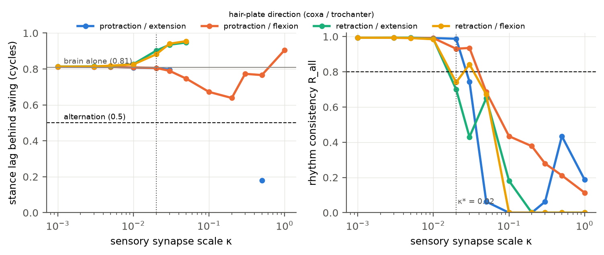

# Paper 2, stage 2B-κ: sensory synaptic efficacy

Results record for the stage pre-registered as amendment A8 of the [protocol](paper2_protocol.md), with κ\* frozen by A9. Run 15–16 November 2026.

## Question

Stage 2B showed that proprioceptive feedback at the central synaptic scale latches or disrupts the front-leg CPG ([paper2_stage2B.md](paper2_stage2B.md)). Is there a sensory synaptic efficacy, fixed by independent physiology, at which feedback paces the rhythm into swing/stance alternation or couples the legs?

## Method

- **New parameter (ENGINEERED):** one multiplier κ on the outgoing synapses of the 31 included afferents. Central synapses, the frozen motor bridge (A7) and the transduction are unchanged; at κ = 1 the runner reproduces stage 2B bit for bit (test).
- **Independent calibration** (A8), on replicates 960–1023 only. DN drive off, no body; afferents driven by the recorded walking clip's angles and velocities (r\* = 100 Hz, all 4 hair-plate cells). The anchor is Azevedo et al. 2020 (eLife 9:e56754): leg feedback evokes PSPs in leg motor neurons that typically fail to elicit spikes, and fast motor neurons never spike from feedback. Criteria: no largest-size-tercile motor neuron active (C1), and at most a third of each leg's motor neurons active (C2), in ≥ 95% of replicates. κ\* is the largest grid κ meeting both.
- **Confirmatory test:** the stage 2B design at κ\* (bilateral DNg100, tethered FlyBody, 4 hair-plate cells × 5 conditions, replicates 0–63; 896 runs), with the unchanged read-out and pass rules.
- **Descriptive scan:** closed loop, scrambled and mismatched at all 12 grid κ, replicates 0–15 (2,304 runs).
- All 6,272 runs (calibration, confirmatory, scan) completed with no failures and no invalid rates.

## Calibration: κ\* = 0.02, "feedback ineffective"

| κ | C1 and C2 in all 4 cells | Median active MNs, L/R (protraction cells) |
|---|---|---|
| 1 – 0.2 | no (C1 fails: fast-proxy MNs active) | 20–35 / 4–29 |
| 0.1 | no | 6–10 / 0–1 |
| 0.05, 0.03 | no (protraction cells fail C1) | 1–4 / 0 |
| **≤ 0.02** | **yes** (100% of replicates) | 0 / 0 |

- **κ\* = 0.02.** At κ\*, no smallest-tercile motor neuron is active in any replicate, so the pre-registered label is "feedback ineffective".
- **No size-ordered recruitment.** On the whole grid, no κ lets afferent drive activate small (slow-proxy) motor neurons while sparing the largest. At κ = 0.1, smallest-tercile motor neurons are active in 72–94% of protraction-cell replicates, but so are largest-tercile ones.
- **The mismatch with the animal.** The flies Azevedo recorded show size-ordered recruitment by feedback; this connectome-based rate model, at any single sensory scale, does not.

## Confirmatory result at κ\* (pre-registered): negative

No cell passes within-leg alternation or left/right coupling, so there is no positive verdict.

Left front leg (T1L) in closed loop at κ\* = 0.02, compared with open loop (0.81, R_all 0.99, 64 of 64 measurable):

| Hair-plate cell | Mean stance lag (cycles) | R_all | Measurable / 64 | L–R PLV |
|---|---:|---:|---:|---:|
| protraction–extension | 0.80 | 0.99 | 64 | 0.13 |
| protraction–flexion | 0.80 | 0.96 | 62 | 0.13 |
| retraction–extension | 0.89 | 0.62 | 46 | 0.11 |
| retraction–flexion | 0.87 | 0.77 | 54 | 0.12 |

- **No latching:** unlike stage 2B, closed loop no longer latches the leg, and the rhythm survives.
- **No re-timing toward alternation:** feedback leaves the swing/stance lag at the open-loop value (protraction cells) or pushes it slightly further from 0.5 (retraction cells).
- **No coupling:** the legs stay uncoupled (PLV ≈ 0.1; null p99 ≈ 0.25–0.29).
- **Controls look the same:** scrambled and mismatched controls behave like closed loop. Full tables are in `docs/papers/data/stage2Bk_confirm_readout.json`.

## Descriptive scan (16 replicates per κ; no pass claims)

*Figure 6. Left front leg in closed loop, by hair-plate cell. Left: mean stance-behind-swing lag (shown where ≥ 4 of 16 replicates are measurable); dashed line, alternation; grey line, open loop. Right: rhythm consistency R_all (unmeasurable replicates count against it); dashed line, pass level 0.8. Dotted line: κ\*.*

- **κ ≤ 0.01:** feedback has no detectable effect (lag 0.81–0.83, R_all ≥ 0.98).
- **κ 0.02–0.05:** feedback begins to act, but in three cells it pushes the lag *away* from alternation (0.88–0.96) as rhythm consistency falls.
- **κ ≥ 0.1:** the rhythm collapses into latching (R_all ≤ 0.43; several cells have no measurable replicate).
- **The closest approach to alternation:** protraction–flexion at κ = 0.1–0.2 (lag 0.64–0.67), with consistency already low (R_all 0.38–0.43).
- **Left/right PLV** stays ≈ 0.13–0.15 except in the latched regime.

## Interpretation

Across a 1,000-fold range of sensory synaptic efficacy, single-scale proprioceptive feedback through these afferents does not convert the CPG's swing/stance offset into alternation, and it does not couple the legs. It is either too weak to change the phase, or strong enough to degrade and then latch the rhythm. The transition between the two regimes is narrow (κ ≈ 0.02–0.1) and passes through no alternating state.

Together with the calibration finding, this localises the gap. The model lacks something that sets *which* motor neurons feedback recruits and *when*. The candidates, each testable next:

1. **Per-synapse-class efficacy.** Size-ordered recruitment implies feedback efficacy that differs by target, not one global scale. Graded strength by motor-neuron size is one physiological candidate; it would need its own pre-registered derivation.
2. **Phase-dependent presynaptic inhibition.** In real flies, hook (movement) afferents are presynaptically inhibited during walking (Dallmann et al. 2025, Nature); the 9A GABAergic neurons that do this are in the connectome. In this rate model their effect is a weak subtraction, not gain control.
3. **Load feedback.** It is absent with legs in air, and the left front leg has no campaniform sensilla in this network.
4. **Spiking or graded dynamics** in afferents and premotor neurons, in place of the half-tanh rate units.

## Limitations

- **Hair-plate direction** is unknown; all four combinations were run.
- **r\* = 100 Hz** is an assumption, since no Drosophila proprioceptor spike rates are published.
- **Size terciles** stand in for motor-neuron speed class.
- **The right femur** calibration criterion failed (A7).
- **Torque actuation (R1)** was not run.
- **The scan** uses 16 replicates per κ.
